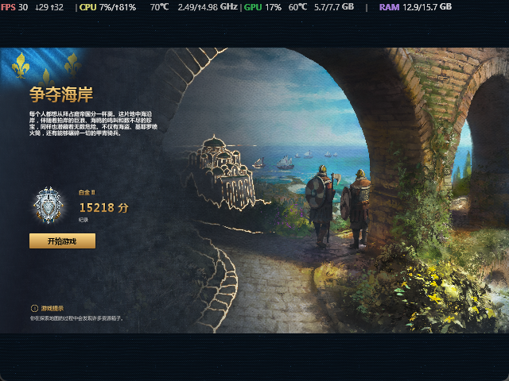
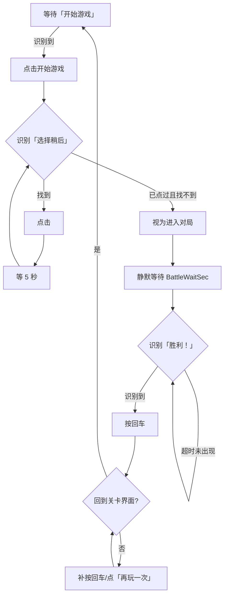

# 帝国时代4 · 炼狱天赋点挂机 v1.0

> 一个 96 KB 的单文件小工具：自动完成《帝国时代4》炼狱模式的「开始游戏 → 选择稍后 → 打完 → 下一局」循环，挂机刷天赋点。
> 纯屏幕识别 + 模拟鼠标键盘，**不读写游戏内存、不注入、不改任何游戏文件**。

```
平台    Windows 10 / 11（64 位）
运行库  .NET Framework 4.x（Win10/11 自带，无需安装）
体积    单文件 96 KB，免安装、免管理员（游戏以管理员启动时才需要）
```

---

## 目录

- [一、这是什么](#一这是什么)
- [二、原理](#二原理)
  - [1. 刷点思路从哪来](#1-刷点思路从哪来)
  - [2. 脚本的技术实现](#2-脚本的技术实现)
  - [3. 一局的完整时序](#3-一局的完整时序)
- [三、相比原脚本改了什么](#三相比原脚本改了什么)
- [四、快速开始](#四快速开始)
- [五、配置](#五配置)
- [六、常见问题](#六常见问题)
- [七、自己编译](#七自己编译)
- [八、换模板（游戏 UI 更新后）](#八换模板游戏-ui-更新后)
- [九、文件结构](#九文件结构)
- [十、免责声明](#十免责声明)
- [十一、致谢](#十一致谢)
- [十二、来源与授权](#十二来源与授权)

---

## 一、这是什么

《帝国时代4》炼狱模式的关卡可以反复快速通关，通关给天赋点。理论上只要把「开一局 → 打完 → 再来一局」这个循环无限重复，天赋点就会自己涨——但这个循环每次都要人盯着点按钮，纯坐牢。

这个小工具就是把这段坐牢时间接管掉：

- 识别并点击「**开始游戏**」
- 识别并点击「**选择稍后**」（这是本版的重点，见[第三节](#三相比原脚本改了什么)）
- 等对局打完，识别「**胜利！**」
- 自动回到关卡界面，进入下一轮
- 全程在控制台打印进度，卡住了能一眼看出卡在哪一步

开局界面（640×480）长这样，程序就是在这个界面开始找按钮：



---

## 二、原理

### 1. 刷点思路从哪来

**刷天赋点的思路不是我想的**，来自 B 站 UP 主 **村长poi** 的视频：

> 【【帝国时代4】论如何高效的刷炼狱天赋点！】
> <https://www.bilibili.com/video/BV1pFx16cEVr/>

具体怎么选增益、怎么压缩单局时长、为什么这套打法效率最高，**请以原视频为准**，这里不复述也不改写——原作者的讲解比我转述靠谱。

本工具只做执行层：把「一局结束再来一局」这个动作自动化，不改变、也不优化原视频里的打法本身。

### 2. 脚本的技术实现

整个程序就是一个**状态机 + 模板匹配**，没有任何游戏内部数据。

#### (1) 找窗口

按窗口标题包含 `Age of Empires IV` 枚举顶层窗口，取得客户区句柄。之后所有坐标都以**客户区**为准，不是屏幕坐标、也不是整个窗口（含边框）。

#### (2) 截图

用 `GDI+ CopyFromScreen` 截客户区。两条通路：

| 通路 | 输出 | 用在哪 |
|---|---|---|
| 归一化截图 | 缩放到固定的 **640×480** 参考系 | 「开始游戏」「胜利！」「再玩一次」 |
| 原生截图 | 客户区原始像素尺寸 | 「选择稍后」 |

固定 640×480 的好处是：内置模板只需按一种尺寸裁一次，窗口大小变了也能匹配（代价是缩略画质，所以小按钮另走原生通路）。

#### (3) 识别 —— 零均值归一化互相关（ZNCC）

不是简单比像素差，而是把模板和待检区域都转灰度、去均值，算归一化相关系数：

```
score = Σ((I - Ī)(T - T̄)) / (‖I - Ī‖ · ‖T - T̄‖)
```

得分落在 `[-1, 1]`，1.00 = 完全一致。这样做的好处：

- **对亮度/对比度不敏感** —— 白天晚上、显示器不同色温、开了 HDR 都能认；
- **有统一的阈值语义** —— 0.85 就是 0.85，换张图不用重调。

搜索策略是由粗到细：

```
降采样粗搜（步长 2） → 局部步长 1 → 全分辨率精修 → ±4% 尺度精修 → 局部打磨
```

「选择稍后」还额外做**多尺度搜索**（0.60×～1.50× 共 17 档），因为它是原生分辨率裁的图，游戏里 UI 缩放一变按钮大小就跟着变。命中后会**缓存这个尺度**，下次直接优先用，从 2 秒降到 0.3 秒左右。

实测得分（内置模板 vs 真实画面）：

| 目标 | 阈值 | 实测 |
|---|---|---|
| 开始游戏 | 0.70 | 0.97 ~ 1.00 |
| 胜利！ | 0.70 | 0.97 ~ 1.00 |
| 选择稍后 | **0.85** | 0.97 ~ 1.00 |
| 无关画面（负样本） | — | ≤ 0.77 |

阈值 0.85 是刻意从严：宁可认不出（会等到超时，然后进下一轮），也不要在别的画面上误点一下。

#### (4) 点击

坐标换算用的是**刚才那张截图的基准**，而不是点击时重新查询窗口位置：

```
屏幕坐标 = ClientToScreen(0,0)@截图时刻 + 截图内坐标
```

原因很实际：截图和点击之间窗口可能被拖动/缩放，二次取基准会导致偏移几个像素，而按钮又不大。点之前会 `SetForegroundWindow` 切前台（配合 `AttachThreadInput` 绕过前台锁定），再用 `SendInput` 发真实的鼠标事件——不是 `SetCursorPos` 假点。

#### (5) 循环



### 3. 一局的完整时序

```
[关卡界面] ──点击「开始游戏」──> [选增益面板] ──点击「选择稍后」──> [对局中]
                                                                      │
                                                        静默等待 240 秒
                                                                      │
                                                                      ▼
[关卡界面] <──下一轮── [按回车] <──识别到「胜利！」<── 开始检测「胜利！」
```

「静默等待」是为了省 CPU：刚进对局那几分钟不可能出现「胜利！」，没必要每秒去匹配十几次图。默认 240 秒（4 分钟），按你实际单局时长调。

---

## 三、相比原脚本改了什么

原脚本来自 B 站 UP 主 **千层雪_Yuki**：

> 【炼狱模式全自动练天赋脚本~一天练满不再坐牢~【帝国时代4】】
> <https://www.bilibili.com/video/BV1sVxd6wEsq/>

原脚本已经把主流程做对了，我用它是真的省了很多事。下面这些是我在实际用下来之后，觉得**需要改**的地方。核心只有一个动机：**别让程序替我选增益**。

| 项 | 原脚本 | 本版 |
|---|---|---|
| **增益面板怎么处理** | 识别到「选择一项增益」面板后，**点击客户区中心 (320,240)** 确认 | 识别并点击「**选择稍后**」按钮本身 |
| **点击后复检** | — | 点完**等 5 秒重新检测**，按钮还在就再点，**最多 3 次** |
| **按钮定位方式** | 640×480 画布 + 固定 ROI 区域 | **原生分辨率、全幅搜索**，不限定位置 |
| **尺度适应** | 单尺度 | 17 档多尺度 + 缓存命中尺度 |
| **启动自检** | — | 5 步自检，失败直接指出是哪一步 |
| **终端输出** | — | 步骤化（`▶ ✓ … ! ✗`）、带耗时、带卡点定位 |
| **分辨率不符** | — | 红色 `! 分辨率不符` 提示，但仍继续尝试 |
| **失败取证** | — | 自动保存「差一点没认出」的画面为 `miss_*.png` |

### 1. 最重要的改动：「选择稍后」

原脚本在这一步是**点客户区中心**。问题是——面板弹出来的时候，中心点到底落在哪个选项上，取决于你当时面板的布局和已经解锁的增益数量。也就是说，**程序实际上是在替你随机选一个增益**。

而中心点具体压在哪个选项上，取决于面板当时的布局——也就是说，这一步实际是程序在替我挑增益，我并没有真的在「选择稍后」。

改法很直接：

1. 用按钮截图做模板，在**整幅原生画面**里找「选择稍后」并点它；
2. 点完**等 5 秒**再查一次——面板有动画，有时第一下没生效；
3. 如果还在，**再点一次**，最多重复 2 次（合计最多 3 次）；
4. 按钮消失 = 已经进对局；连点 3 次还在 = 也进下一步，不卡死。

因为「选择稍后」在游戏里的位置会随面板内容浮动，所以搜索范围不设 ROI，直接全图扫，多尺度兜住 UI 缩放差异。

### 2. 终端输出改成「能看出卡在哪」

原来出问题不好定位。现在每一步都有固定的开头标记，**最后一行 `▶` 就是卡点**：

```
▶ 第 1 轮 · 点「开始游戏」并等待「选择稍后」
  ✓ 识别到「开始游戏」（相似度 1.00），点击（0.8 秒）
  ✓ 识别到「选择稍后」（相似度 0.97，尺度 1.00x），第 1 次点击
  ✓ 第 1 次点击后已看不到「选择稍后」，视为已进入对局（5.2 秒）
▶ 第 1 轮 · 对局等待 240 秒（期间不检测胜利）
      … 已 30 秒 / 共 240 秒
```

| 符号 | 含义 |
|---|---|
| `▶` | 进入某一步 |
| `✓` | 成功，括号里是耗时 |
| `…` | 还在等（带已等秒数，证明程序没死） |
| `!` | 需要注意（分辨率不符、相似度不够） |
| `✗` | 失败 |

配合启动时的 5 步自检（载入配置 → 解模板 → 找窗口 → 查分辨率 → 输入自检），大部分问题在按下第一次点击之前就能暴露出来。

### 3. 其余小改进

- **分辨率提示**：客户区不是 640×480 时打红字警告，但**不退出**——很多人其实是可用的，只是分数偏低。
- **失败自动留证**：「选择稍后」相似度落在 0.55~0.85 之间时，自动把这一帧存成 `miss_HHmmss_fff_<分数>.png`（限流 8 秒一次、最多 20 张）。换模板、调阈值全靠这个。
- **胜利后的兜底链**：先按回车（原逻辑）→ 还停在结算画面就补按两次 → 再无效就找「再玩一次」点它。避免个别情况下卡在结算界面。
- **日志和配置不落桌面**：全部写到 `%LOCALAPPDATA%\AoE4Auto\`，不污染你的桌面。

---

## 四、快速开始

1. 双击 `AOE4炼狱天赋点挂机.exe`。
   - 若被 SmartScreen 拦：点「更多信息」→「仍要运行」，或右键属性勾「解除锁定」。
   - 若游戏是以管理员身份启动的，本程序也要右键「以管理员身份运行」。
2. 游戏窗口**客户区调到 640×480**，停在关卡界面（能看到「开始游戏」那一屏）。
3. 程序倒计时 3 秒后自动开始，此时切回游戏即可。

热键（全局，游戏里也生效）：

| 键 | 作用 |
|---|---|
| **F9** | 暂停 / 继续 |
| **F10** | 立即退出 |

> 详细步骤、每一步终端输出怎么读、每种故障怎么排查 → 见 **[运行方式.md](运行方式.md)**。

---

## 五、配置

首次运行会在 `%LOCALAPPDATA%\AoE4Auto\AoE4Auto.ini` 生成配置，改完**重启程序**生效。

| 键 | 默认 | 说明 |
|---|---|---|
| `StartDelaySec` | 3 | 启动后等几秒再动手（留时间切窗口） |
| `PanelWaitSec` | 240 | 点「开始游戏」后等面板出现的最长秒数 |
| `BattleWaitSec` | 240 | 进对局后**至少**等多久才开始找「胜利！」，按你的单局时长调 |
| `PollMs` | 700 | 轮询间隔（毫秒） |
| `MatchThreshold` | 0.60 | 「开始游戏 / 胜利 / 再玩一次」的阈值（实测 0.97+，0.60 就够） |
| `BriefingTimeoutSec` | 240 | 等「开始游戏」的最长秒数 |
| `VictoryTimeoutSec` | 1500 | 等「胜利！」的最长秒数（超时只警告，不退出） |
| `MaxRounds` | 0 | 跑几轮后停，0 = 无限 |
| `SaveDebugFrames` | 0 | 1 = 每次识别都存图，排查用 |
| `PauseOnExit` | 1 | 退出前是否等按键 |

「选择稍后」的阈值固定 0.85，不跟随 `MatchThreshold`（避免把通用阈值调低时误点）。

命令行（一般用不到）：

```
AOE4炼狱天赋点挂机.exe --detect        只检测不点击，实时打印各模板相似度
AOE4炼狱天赋点挂机.exe --shot 1.png    截一张客户区图，用于重裁模板
AOE4炼狱天赋点挂机.exe --frames        本次运行把每次识别的画面都存下来
AOE4炼狱天赋点挂机.exe --reset-config  用默认值重写配置文件
```

---

## 六、常见问题

| 现象 | 原因 / 处理 |
|---|---|
| 一直「没找到游戏窗口」 | 游戏没开 / 标题不含 `Age of Empires IV` / 最小化了 / 权限不一致 |
| `! 分辨率不符` | 客户区不是 640×480。程序仍会尝试，但识别分数会掉 |
| 一直「还没看到「选择稍后」」 | 面板画面与内置模板有差异（UI 缩放、语言、皮肤）。用 `--shot` 截一张发上来重裁 |
| 点了没反应 | 权限问题（用管理员运行），或游戏是**全屏独占**模式 → 改窗口化 |
| 胜利后卡住 | 看日志停在 `等待回到关卡界面`；兜底链会依次尝试回车 → 补回车 → 点「再玩一次」 |

更多排错见 **[运行方式.md](运行方式.md)**。

---

## 七、自己编译

源码是**自包含**的：模板是 Base64 常量写在 `Templates.cs` 里的，不依赖任何外部图片、DLL 或 NuGet 包。整个程序只引用了 .NET Framework 自带的三个程序集。

### 方式 A：build.ps1（推荐，什么都不用装）

```powershell
cd src
.\build.ps1
# 产物：src\dist\AOE4炼狱天赋点挂机.exe
```

脚本只用系统自带的 `csc.exe`（Win10/11 的 .NET Framework 4.x 就有），**不需要 Visual Studio，也不需要 .NET SDK**。若提示脚本被禁止执行：

```powershell
powershell -ExecutionPolicy Bypass -File .\build.ps1
```

### 方式 B：Visual Studio

打开 `src\AoE4Auto.csproj`（需要 VS 2019+ 的「.NET 桌面开发」工作负载，目标框架 .NET Framework 4.8），直接 F5 / 生成即可。

### 编译参数

```
csc /target:exe /platform:anycpu32bitpreferred /optimize+ /codepage:65001 ^
    /win32manifest:app.manifest /out:AOE4炼狱天赋点挂机.exe ^
    /r:System.dll /r:System.Drawing.dll /r:System.Windows.Forms.dll ^
    AoE4Auto.cs Templates.cs
```

| 参数 | 为什么 |
|---|---|
| `/target:exe` | 控制台子系统——进度要打在控制台里（WinForms 窗体是隐藏运行的，只为了接全局热键） |
| `/platform:anycpu32bitpreferred` | 32 位优先。64 位进程向 32 位游戏发 `SendInput` 更容易被拦 |
| `/codepage:65001` | 源码是 UTF-8，不指定的话 csc 会按 ANSI 读，中文全变乱码 |
| `/win32manifest:app.manifest` | DPI 感知（`permonitorv2`）+ `asInvoker`。**改成 `requireAdministrator` 会被 SmartScreen 拦**——这是踩过的坑 |

### 关于「编出来的 exe 和 release 里的不一样」

SHA256 对不上是**正常的**：`csc.exe`（v4.0.30319）不支持确定性构建，每次编译都会写入新的 PE 时间戳和随机的模块 MVID，哪怕源码一字不改，两次编译的哈希也不同。

能验证的是**行为等价**：同一张测试图，release 里的成品和用本仓库源码重新编译的产物，`--selftest` 输出完全相同（`score=0.742 x=363 y=717 scale=1.34`），IL 段大小也一致。

---

## 八、换模板（游戏 UI 更新后）

游戏更新后按钮变了样，程序会一直报「还没看到…」。这时需要重裁模板——不用改任何逻辑代码，只换 `Templates.cs` 里的 Base64 常量。

### 1. 截一张真实画面

```powershell
.\AOE4炼狱天赋点挂机.exe --shot shot.png
```

截的是**客户区**，尺寸就是你游戏窗口的客户区尺寸。

### 2. 裁出按钮

用任意看图/截图工具，裁成**刚好包住按钮文字**的小图（周围留 1~2 像素，别带背景纹理）。

### 3. 转成 Base64 并替换

```powershell
[Convert]::ToBase64String([IO.File]::ReadAllBytes('.\btn.png'))
```

打开 `src\Templates.cs`，找到对应常量，把字符串换掉：

| 常量 | 对应按钮 | 在哪个参考系里匹配 |
|---|---|---|
| `BriefingB64` | 开始游戏 | 640×480 归一化画布 |
| `VictoryB64` | 胜利！ | 640×480 归一化画布 |
| `ReplayB64` | 再玩一次 | 640×480 归一化画布 |
| `WaitB64` | 选择稍后 | **原生分辨率**（全幅搜索） |
| `PanelB64` | 选择一项增益面板 | 640×480 归一化画布 |

### 4. 重编并验证

```powershell
cd src; .\build.ps1
.dist\AOE4炼狱天赋点挂机.exe --selftest 你的截图.png
```

`--selftest` 会打印命中坐标、相似度、尺度，不需要开游戏就能验证模板对不对。

> 前三个模板请**在 640×480 客户区下截图再裁**，否则尺寸对不上。选择稍后（`WaitB64`）反而是原生分辨率裁的，因为它走全幅多尺度搜索。

---

## 九、文件结构

```
/
├── README.md                    # 本文件
├── 运行方式.md                   # 详细运行说明 + 排错手册
├── 开始位置.png                  # 关卡界面参考图（640×480）
├── AOE4炼狱天赋点挂机.exe         # 成品（单文件 96 KB，直接能用）
├── LICENSE                      # MIT
├── .gitignore
└── src/
    ├── AoE4Auto.cs              # 全部逻辑：找窗口 / 截图 / 匹配 / 点击 / 状态机
    ├── Templates.cs             # 5 个内置模板（Base64 PNG 常量）
    ├── app.manifest             # DPI 感知 + asInvoker
    ├── AoE4Auto.csproj          # VS 工程文件
    └── build.ps1                # 一键编译（只依赖系统自带 csc.exe）
```

运行时生成（不随仓库分发）：

```
%LOCALAPPDATA%\AoE4Auto\
├── AoE4Auto.ini     # 配置
├── AoE4Auto.log     # 日志
└── frames\          # 调试图（仅在 SaveDebugFrames=1 或 --frames 时）
```

删除整个目录即完成卸载——程序**不写注册表、不加开机启动**。

---

## 十、免责声明

- 本工具仅做**屏幕截图 + 模拟鼠标键盘**，不读取/修改游戏内存，不注入进程，不修改任何游戏文件，不含任何反作弊绕过手段。
- 使用的全部是你屏幕上看得到的信息，和使用鼠标宏、按键精灵属于同一类。
- 仅限**单人 PvE 内容**（炼狱模式关卡）离线挂机使用。**不要**用于多人对战，否则后果自负。
- 仅供个人学习自动化与图像识别技术使用。因使用本工具导致的账号风险、数据损失等，作者不承担任何责任。
- 游戏版本更新后 UI 可能变化，导致模板失效——这属于正常现象，按[第六节](#六常见问题)重新截图换模板即可。

---

## 十一、致谢

这个工具能存在，完全是因为前面两个人把路先趟了一遍：

### 村长poi —— 刷点思路

> 【【帝国时代4】论如何高效的刷炼狱天赋点！】
> <https://www.bilibili.com/video/BV1pFx16cEVr/>

本工具**整个存在的前提**就是这套刷法。没有「炼狱关卡可以反复快速通关换天赋点」这个认知，根本不会有自动化的想法。怎么打、选什么、为什么快，都在视频里。

### 千层雪_Yuki —— 原挂机脚本

> 【炼狱模式全自动练天赋脚本~一天练满不再坐牢~【帝国时代4】】
> <https://www.bilibili.com/video/BV1sVxd6wEsq/>

原脚本把「找窗口 → 截图 → 模板匹配 → 点击 → 循环」这条链路完整跑通了，本版的 C# 源码是在它的 exe 基础上**反编译重建**的，整体结构和流程都沿用原脚本，我只改了增益面板那一步，外加把终端输出做厚了一点。

原脚本本身已经足够可用，如果你不需要「选择稍后」这个行为，直接用原脚本就好，没必要折腾这个版本。

**感谢两位 UP 主的分享。**

---

如果有帮助，去 B 站给上面两个视频点个赞，比给我 star 有意义得多。

---

## 十二、来源与授权

- **刷点思路**：B 站 UP 主 **村长poi** ——【[【帝国时代4】论如何高效的刷炼狱天赋点！](https://www.bilibili.com/video/BV1pFx16cEVr/)】
- **原挂机脚本**：B 站 UP 主 **千层雪_Yuki** ——【[炼狱模式全自动练天赋脚本~一天练满不再坐牢~【帝国时代4】](https://www.bilibili.com/video/BV1sVxd6wEsq/)】
- 本仓库的 C# 源码是把原脚本的 exe **反编译重建**成可编译工程后改造而来，**已征得原作者同意后开源**。原始程序的著作权归原作者所有，本仓库的改动部分以 [MIT](LICENSE) 协议发布。
- 只想用、不想看代码的话，`AOE4炼狱天赋点挂机.exe` 就是全部；源码是给「想自己改两行」和「想确认它没干别的」的人准备的。

